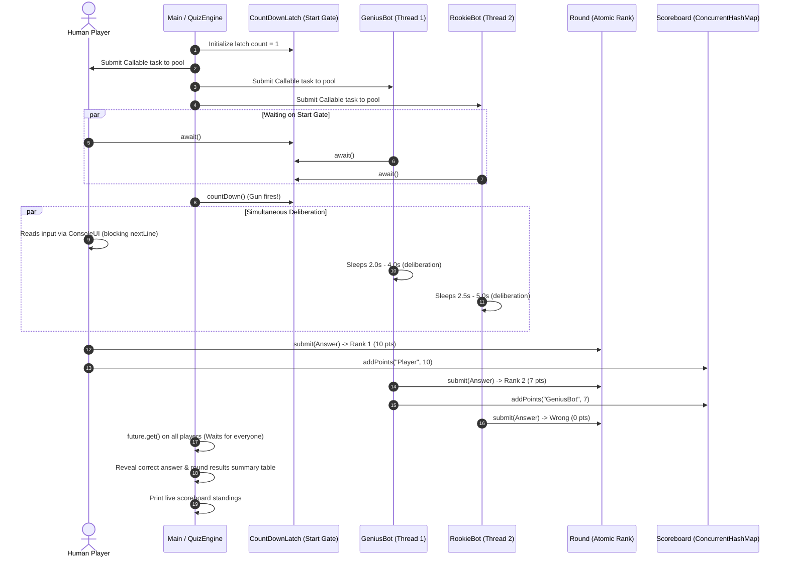
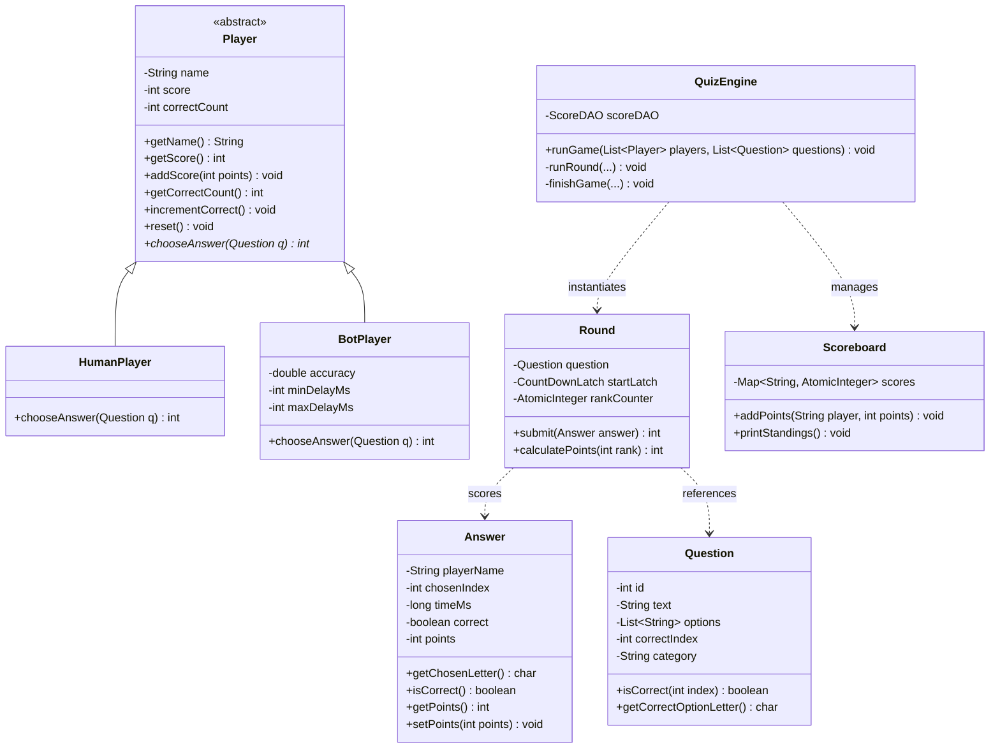
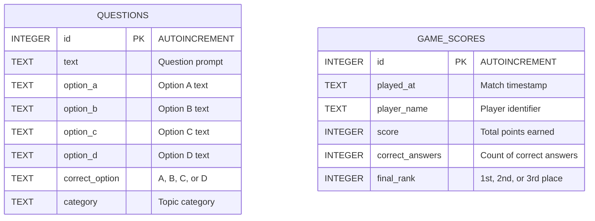

# Multiplayer Quiz Battle (Terminal Edition)

A concurrent multiplayer quiz game built in Java 17 with SQLite persistence, zero external frameworks, and intermediate-level Object-Oriented Programming and multithreading concepts. The application simulates real-time competitive trivia between a human player and autonomous bot opponents over a shared terminal interface.

---

## 1. Problem Statement

Standard student terminal applications are typically single-threaded, sequential, and lack persistent state. In real-world multiplayer applications, participants interact simultaneously, causing race conditions when accessing shared state like scoreboards and rank counters. This project addresses the need for a realistic yet accessible demonstration of core computer science concepts: orchestrating concurrent threads without race conditions, safely coordinating simultaneous task starts, preventing input starvation, and persisting match outcomes atomically into an embedded relational database using pure standard JDBC.

---

## 2. Objectives and Scope

### Measurable Objectives
- **Simultaneous Round Start**: Release 3 player threads (1 human + 2 bots) at the exact same millisecond using `java.util.concurrent.CountDownLatch`.
- **Race-Free Rank Scoring**: Award rank-based points (1st = 10, 2nd = 7, 3rd = 5) atomically without locks or duplicate ranks using `AtomicInteger`.
- **ACID Database Transactions**: Persist all player scores for a finished match within a single database transaction (`setAutoCommit(false)`, batch insertion, and rollback on failure).
- **Clean 3-Layer Architecture**: Maintain clear separation across CLI, Service, and DAO layers with all 15 Java files kept under 150 lines.

### Project Scope
- **In Scope**:
  - 1 Human player competing in real time against 2 autonomous bots (`GeniusBot` with 90% accuracy and `RookieBot` with 40% accuracy).
  - Untimed rounds that wait until all players have submitted their answers.
  - Spoiler-free live round feedback (notifying when players answer without disclosing the chosen option).
  - Persistent SQLite storage for questions bank and match score history.
  - Interactive CLI menus for playing, viewing all-time leaderboards, player career stats, question CRUD, and an interactive concurrency demo.
- **Out of Scope**:
  - Network sockets and client-server distribution (all concurrency runs locally via JVM threads).
  - Graphical User Interface (GUI) or web frontends.
  - Third-party ORM libraries (Hibernate, Spring) or connection pooling frameworks.

---

## 3. Features Implemented

- [x] **Human vs. Bot Multiplayer**: 1 human player competing against 2 bot personalities with staggered delays (2 to 5 seconds).
- [x] **Lock-Free Concurrency**: Synchronized starting gate (`CountDownLatch`) and atomic first-come, first-served rank allocation (`AtomicInteger`).
- [x] **Untimed Rounds**: Every round runs until all players answer; no player is cut off by a timer.
- [x] **Fair Play Output**: Bot answers are hidden during deliberation; full round breakdowns are revealed only after all players finish.
- [x] **Interactive CLI Menus**:
  1. Play a game (prompts for player name and question count).
  2. All-time leaderboard (top 5 by cumulative points).
  3. Individual player career statistics.
  4. Add new questions to the bank.
  5. View and delete questions.
  6. Concurrency demonstration (proves race conditions with 20 threads and 20,000 increments).
  0. Exit.
- [x] **SQLite Persistence**: Embedded relational database (`quizbattle.db`) with automatic table creation and starter question seeding.
- [x] **ACID Transactions**: Atomic batch insertion of match scores using standard JDBC transaction controls.

---

## 4. Tech Stack

- **Language**: Java 17 (LTS)
- **Build Tool**: Apache Maven 3.8+
- **Database**: SQLite 3 (embedded file-based database)
- **JDBC Driver**: `org.xerial:sqlite-jdbc:3.45.2.0`
- **Testing**: JUnit Jupiter 5.10.2 (2 focused unit tests)
- **Third-Party Frameworks**: None (Pure standard Java SE)

---

## 5. Project Structure

```
Multiplayer Quiz Java/
├── pom.xml                                    # Maven configuration (sqlite-jdbc & JUnit 5)
├── run.sh                                     # Bash launch script (Mac/Linux)
├── .gitignore                                 # Git exclusions (target/, *.db, IDE configs)
├── README.md                                  # Academic project documentation
├── src/main/resources/
│   ├── schema.sql                             # DDL for questions and game_scores tables
│   └── seed.sql                               # Starter questions (Science & History)
├── src/main/java/quizbattle/
│   ├── Main.java                              # CLI menu and concurrency demonstrator
│   ├── model/
│   │   ├── Player.java                        # Abstract base class for competitors
│   │   ├── HumanPlayer.java                   # Human player using blocking console input
│   │   ├── BotPlayer.java                     # Autonomous bot with delay & accuracy
│   │   ├── Question.java                      # Immutable question domain model
│   │   └── Answer.java                        # Value object for player submissions
│   ├── service/
│   │   ├── QuizEngine.java                    # Multithreaded round loop & thread coordination
│   │   ├── Round.java                         # Start latch & lock-free rank scoring
│   │   └── Scoreboard.java                    # Thread-safe scores using ConcurrentHashMap
│   ├── dao/
│   │   ├── DBConnection.java                  # Connection manager & startup schema initializer
│   │   ├── QuestionDAO.java                   # CRUD operations for trivia questions
│   │   └── ScoreDAO.java                      # Single-transaction batch score recorder & stats
│   ├── util/
│   │   ├── Constants.java                     # Rank points and ANSI terminal colors
│   │   └── ConsoleUI.java                     # Shared Scanner & safe user input utilities
│   └── exception/
│       └── DataAccessException.java           # Unchecked domain exception wrapping SQLException
└── src/test/java/quizbattle/
    ├── QuestionTest.java                      # Unit test for question option verification
    └── RoundConcurrencyTest.java              # Concurrency test for unique ranks under 20 threads
```

---

## 6. Setup and Run Instructions

### Prerequisites
- **Java 17 Development Kit (JDK 17)** or higher installed.
- **Apache Maven 3.8+** installed.

### 1. Compile & Run Tests
```bash
mvn clean test
```

### 2. Launch the Game
- **macOS / Linux**:
  ```bash
  chmod +x run.sh
  ./run.sh
  ```
- **Windows (Command Prompt / PowerShell)**:
  ```cmd
  mvn compile
  java -cp "target/classes;lib/*" quizbattle.Main
  ```
- **Direct Java Launch (All Platforms)**:
  ```bash
  mvn package -DskipTests
  java -jar target/multiplayer-quiz-java-1.0.0.jar
  ```

---

## 7. Concurrency Flow Diagram



---

## 8. Class Diagram



---

## 9. Entity-Relationship (ER) Diagram



---

## 10. Pending Work & Future Enhancements

The following features are planned for future project milestones:
1. **Interactive Lifelines**: Implement 50-50 (eliminates two wrong options) and Double Points lifelines.
2. **Tournament Mode**: Multi-game championship matches with cumulative point tracking across rounds.
3. **Category & Difficulty Expansion**: Expand question bank to 100+ questions with category filters and difficulty scaling.
4. **Configurable Round Timers**: Add an optional countdown timer mode with non-blocking user input as an advanced gameplay option.

---

## 11. Milestone Evidence (Completed Items)

- [x] **Zero External Frameworks**: Plain Java 17 and SQLite JDBC driver only.
- [x] **File Size Constraint**: All 15 Java source files are strictly under 150 lines.
- [x] **Thread Pool Management**: Fixed pool with `Executors.newFixedThreadPool(players.size())` and graceful shutdown in a `finally` block.
- [x] **Thread Coordination**: `CountDownLatch(1)` ensures simultaneous round starts across threads.
- [x] **Lock-Free Atomic Ranking**: `AtomicInteger.incrementAndGet()` guarantees unique ranks without lock contention.
- [x] **Safe Concurrent Scoreboard**: `ConcurrentHashMap<String, AtomicInteger>` handles thread-safe updates.
- [x] **ACID Transactions**: `setAutoCommit(false)`, `executeBatch()`, `commit()`, and `rollback()` in `ScoreDAO`.
- [x] **Concurrency Race Condition Demonstration**: Option 6 demonstrates plain `int++` data loss (20 threads x 1,000 iterations losing thousands of updates) versus `AtomicInteger` (100% accurate at 20,000).
- [x] **Unit Testing**: 2 focused tests in `src/test/java` passing with 0 failures and 0 errors.

---

## 12. 10 Viva Questions & Answers

### 1. What is the architecture of this project?
The project follows a clean 3-layer architecture:
- **CLI Layer** (`Main`, `ConsoleUI`): Manages menu navigation, human keyboard input, and formatted console printing.
- **Service Layer** (`QuizEngine`, `Round`, `Scoreboard`): Coordinates concurrent game rounds, thread synchronization, and rank-based scoring.
- **DAO Layer** (`DBConnection`, `QuestionDAO`, `ScoreDAO`): Handles database persistence using SQLite and standard JDBC.

### 2. How does multithreading work in each round?
In `QuizEngine`, an `ExecutorService` creates a thread pool with one thread per player. Each player's turn is wrapped inside a `Callable<Answer>` task. All player tasks run concurrently in background threads.

### 3. Why use `CountDownLatch` instead of starting threads in a loop?
Starting threads sequentially in a `for` loop gives earlier threads an unfair head start. A `CountDownLatch(1)` acts as a "starting gun". Each thread calls `startLatch.await()` immediately. Once all threads are submitted, the main thread calls `startLatch.countDown()`, releasing all players at the exact same millisecond.

### 4. How do you prevent race conditions and duplicate ranks when multiple players answer simultaneously?
Inside `Round`, an `AtomicInteger rankCounter` increments via `incrementAndGet()`. This uses CPU-level Compare-And-Swap (CAS) instructions rather than heavy synchronized blocks. Each correct answer receives a guaranteed unique integer rank (1, 2, 3...), ensuring no two players ever receive the same rank or points.

### 5. How does the engine wait for all player threads to finish?
Each player's answer task returns a `Future<Answer>`. In `QuizEngine`, the main thread loops through the list of futures and calls `future.get()` (without a timeout). Calling `future.get()` blocks until that specific player's thread completes. Iterating through all futures guarantees that the round ends only when every single player (human and bots) has finished answering.

### 6. Why use `ConcurrentHashMap` in `Scoreboard`?
Standard `HashMap` is not thread-safe; concurrent writes from multiple threads can corrupt internal hash buckets or cause `ConcurrentModificationException`. `ConcurrentHashMap<String, AtomicInteger>` enables atomic, thread-safe score accumulation across threads without synchronizing the entire table.

### 7. Why is `synchronized (System.out)` used when printing player progress?
Multiple threads complete at different times. If multiple threads call `System.out.printf()` simultaneously, individual characters and lines can interleave and scramble terminal output. Wrapping print blocks in `synchronized (System.out)` guarantees atomic, readable console output.

### 8. How does the application prevent SQL Injection?
All SQL queries in `QuestionDAO` and `ScoreDAO` use `PreparedStatement` with parameterized placeholders (`?`). Parameters are bound using methods like `setString()` and `setInt()`, ensuring input data is never concatenated directly into executable SQL statements.

### 9. How is the database transaction managed when saving game scores?
In `ScoreDAO.saveScores()`, `conn.setAutoCommit(false)` disables auto-commit mode to begin an explicit transaction. All player scores are added via `pstmt.addBatch()` and executed together with `pstmt.executeBatch()`. Then `conn.commit()` commits the records atomically. If any error occurs, `conn.rollback()` in the `catch` block rolls back all changes, preserving database consistency.

### 10. What OOP principles are demonstrated in the code?
- **Abstraction**: `Player` is an abstract class defining shared attributes (`name`, `score`, `correctCount`) and the abstract method `chooseAnswer(Question q)`.
- **Inheritance & Polymorphism**: `HumanPlayer` and `BotPlayer` extend `Player`, each providing distinct `chooseAnswer()` implementations. `QuizEngine` interacts with `List<Player>` polymorphically.
- **Encapsulation**: Models (`Question`, `Answer`) use private fields with public getters, keeping domain state secure and immutable.
